# SpringBots
## Prajjwal Pathak 25/SWE/05
## Faizan Ahmed 25/SWE/07
## Aakash 25/SWE/21
## Vidhi Kaushal 25/SWE/19

<br></br>
# OnboardIQ — Local KYC Onboarding Workbench

OnboardIQ is a local-first KYC (Know Your Customer) onboarding application built for **Case Study 02**. Applicants register, fill an application and upload identity documents. An on-device document AI pipeline (OCR, plus an optional local LLM) reads the documents and extracts fields. A deterministic **R1–R17 rules engine** produces an `APPROVE` / `REVIEW` / `REJECT` result. KYC officers and compliance officers then complete a **maker-checker** review with a full audit trail.

Everything runs on one machine: a single FastAPI process, a SQLite database and a local `uploads/` folder. No cloud service, Docker or external database is required, and no document leaves the machine. All bundled data is synthetic.

---
## Screenshots

### 1. Sign in
Login and registration page with one-click demo accounts. The header chip shows the active OCR engine.

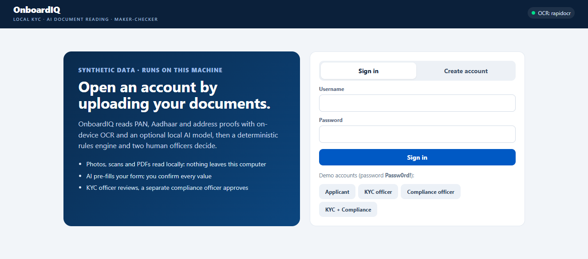

### 2. Applicant: upload documents with OCR autofill
The PAN card, masked Aadhaar and electricity bill are read on-device by RapidOCR. Detected type, extracted fields and read time are shown for each document and used to pre-fill the form.

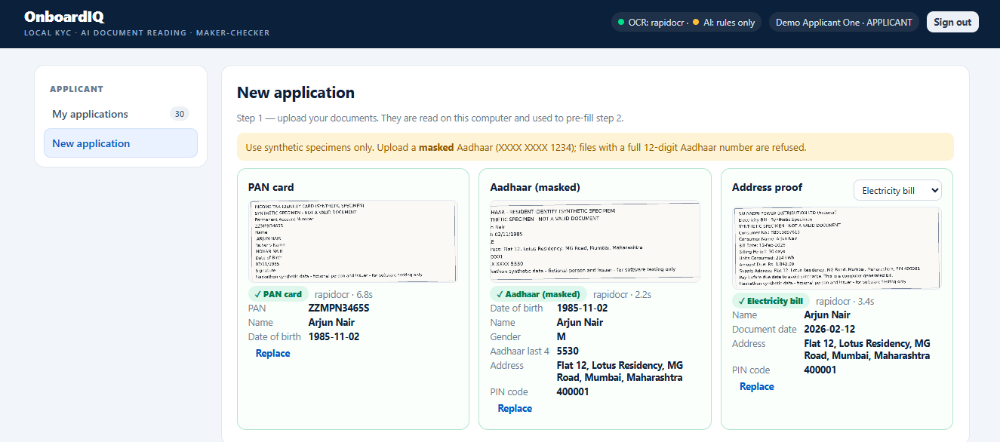

### 3. KYC officer: review queue
Open cases with counts by rules outcome (reject, review, approve) and the reason codes for each application.

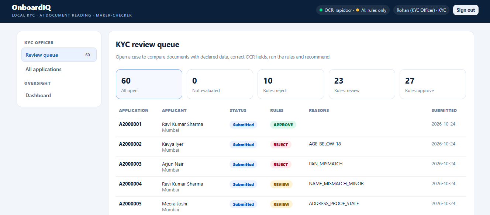

### 4. KYC officer: all applications
Every application with its status, rules outcome and reason codes, filterable by status.

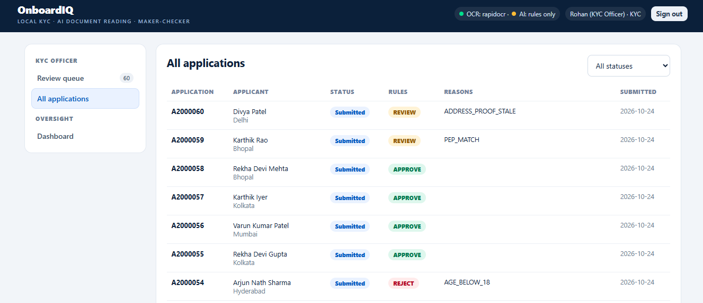

### 5. Case workbench: declared data vs documents
Rules outcome, risk category, name-match score and income, plus a field-by-field comparison of what the applicant declared against what was read from each document.

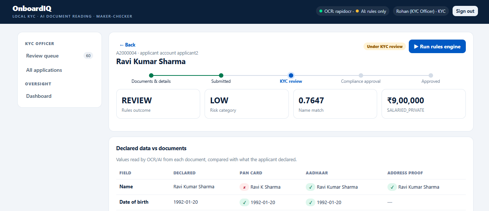

### 6. Case workbench: extracted fields and confidence
Document viewer (original or OCR text) next to the extracted fields, with confidence bars, inline edit for corrections and a re-run of OCR + AI.

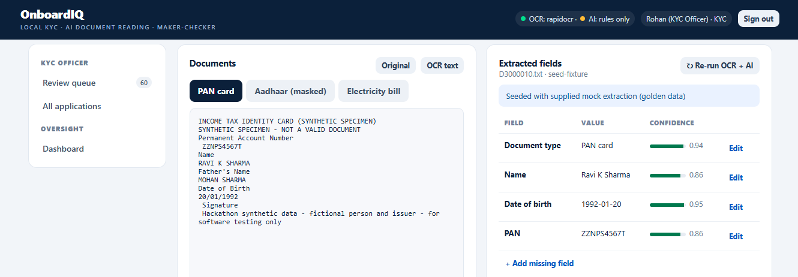

### 7. Maker: rules result and recommendation
The rules engine explains the outcome (here `NAME_MISMATCH_MINOR`). The KYC officer records a rationale and recommends approve, reject or resubmission. Every action appears in the case timeline.

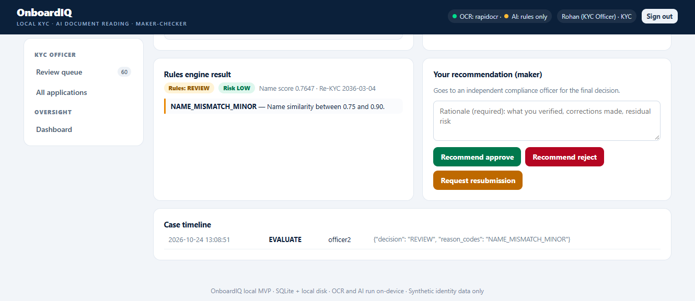

### 8. Checker: final decision
A different user, the compliance officer, sees the maker's recommendation and makes the final decision: approve, reject or send back to the applicant.

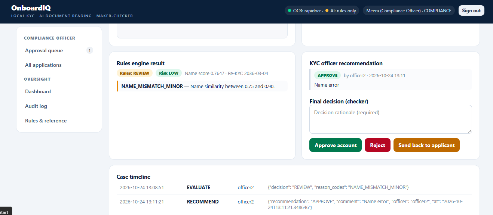

### 9. Operations dashboard
Applications by status, rules outcomes and document AI status (OCR engine, local LLM availability).

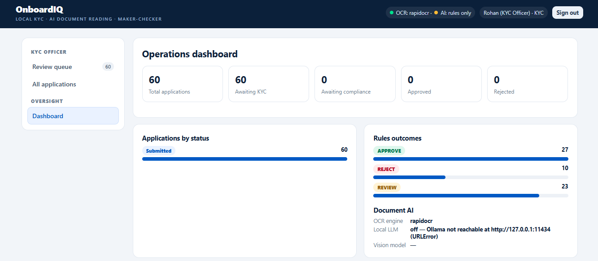

### 10. Audit log
Searchable record of every action, correction and decision, with CSV export.

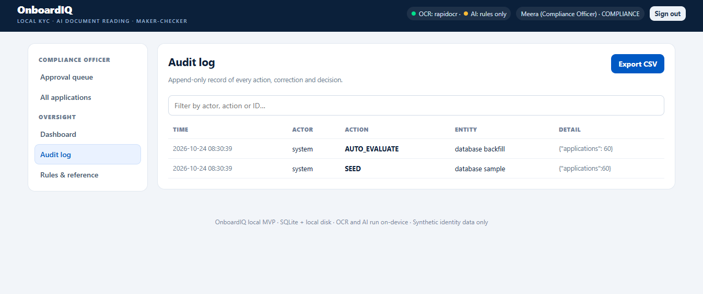
---

## Table of contents

- [Key features](#key-features)
- [Technology stack and versions](#technology-stack-and-versions)
- [System architecture](#system-architecture)
- [End-to-end application flow](#end-to-end-application-flow)
- [Application lifecycle](#application-lifecycle)
- [Rules engine (R1–R17)](#rules-engine-r1r17)
- [Document AI pipeline](#document-ai-pipeline)
- [Prerequisites](#prerequisites)
- [Installation](#installation)
- [Running locally](#running-locally)
- [Demo accounts and roles](#demo-accounts-and-roles)
- [API reference](#api-reference)
- [Frontend views](#frontend-views)
- [Command-line tools](#command-line-tools)
- [Testing and verification](#testing-and-verification)
- [Example requests](#example-requests)

---

## Key features

- **Applicant self-service:** register, give consent, create a draft application, upload documents by drag and drop, auto-fill the form from a scanned PAN card or other document, submit, track progress and respond to resubmission requests.
- **On-device document AI:** reads photos, scans, PDFs and `.txt` OCR text using RapidOCR (ONNX Runtime), Tesseract or PyMuPDF. It classifies the document type and extracts fields with OCR-error repair and per-field confidence scores. An optional local [Ollama](https://ollama.com) LLM cross-checks the extracted fields.
- **Deterministic decisions:** rules R1–R17 read their thresholds, title tokens, occupations, sanctions, PEP and existing-customer lists from `./data`. AI never decides an outcome.
- **Maker-checker workflow:** a KYC officer (maker) evaluates the case, corrects fields with a reason and recommends an outcome. A different compliance officer (checker) makes the final decision.
- **Safety guards:** unmasked 12-digit Aadhaar numbers are rejected before anything is stored. Documents containing instructions aimed at AI or automated systems are flagged and forced to manual review. Document text is passed to the LLM as untrusted, delimited data.
- **Oversight:** dashboard, per-case timeline, searchable audit log, CSV audit export, and read-only views of the rules config and reference data.
- **Batch evaluation:** a CLI that scores the 60-row sample (with verification against expected labels) and the 100-row evaluation set.

---

Created at runtime and git-ignored: `local/onboardiq-local.sqlite3` (database), `uploads/*` (stored documents and OCR text), `output/test_decisions.csv`, `output/extraction_eval.csv`, `.venv/` and `__pycache__/`.

| Path | Responsibility |
|---|---|
| [`local_app.py`](local_app.py) | Creates the SQLite schema on startup (with additive column migrations), seeds demo users and 60 sample applications, defines all HTTP routes, signs and verifies bearer tokens, enforces roles and ownership, writes the audit log, and serves `web/index.html` at `/`. |
| [`ocr_engine.py`](ocr_engine.py) | `extract_document()` pipeline: read text, Aadhaar guard, classify, rule-based field extraction, optional LLM extraction and merge, prompt-injection flag. Also `status()` for engine and LLM availability. |
| [`scripts/run_batch.py`](scripts/run_batch.py) | `RulesEngine` (imported by `local_app.py`) and the batch CLI. |
| [`frontend/`](web/index.html) | The entire frontend: login and registration, applicant, KYC officer and compliance views. It calls `/api/v1/*` with `fetch`. |
| [`data/`](data/) | Inputs read at runtime: `case_02_rules_config_V1.0.json`, occupations, sanctions (50), PEP (60), existing customers (300), sample (60) and eval (100) applications, documents, document text and mock extractions. `case_02_OnboardIQ_V1.0(1).docx` is the case-study brief and is not read by the code. |

---

## Technology stack and versions

| Layer | Technology | Version constraint (from [`requirements-local.txt`](requirements-local.txt)) |
|---|---|---|
| Language | Python | **3.10–3.12 recommended** (see below) |
| Web framework | FastAPI (Pydantic v2 models) | `fastapi>=0.115,<1` |
| ASGI server | Uvicorn | `uvicorn[standard]>=0.30,<1` |
| Uploads | python-multipart | `>=0.0.9` |
| Database | SQLite via Python's built-in `sqlite3` | stdlib |
| File storage | Local filesystem (`uploads/`) | — |
| OCR (default) | RapidOCR (PP-OCR models) on ONNX Runtime | `rapidocr>=3.0,<4`, `onnxruntime>=1.18` |
| OCR (alternative) | Tesseract via pytesseract | `pytesseract>=0.3.10` (needs the Tesseract binary, installed separately) |
| PDF | PyMuPDF | `pymupdf>=1.24` |
| Imaging | Pillow | `Pillow>=10` |
| Optional local LLM | Ollama HTTP API (called with `urllib`, so no extra package) | default model `qwen2.5:3b` |
| Frontend | React JS in one folder frontend |
| Tests | `unittest` (stdlib) + FastAPI `TestClient` | `httpx>=0.27` |

All constraints are lower or upper bounds, not exact pins. There is no lockfile.

### Python version

The repository has no `.python-version`, `pyproject.toml` or CI file that declares a version, so the requirement comes from the code and the dependencies:

- **Minimum 3.10.** `local_app.py` uses `str | None` annotations in FastAPI dependency signatures (for example `current()` and `applications()`). These are evaluated at runtime, so Python 3.9 and older fail on import.
- **Upper bound in practice:** `onnxruntime` publishes wheels for specific Python versions and for 64-bit builds only. On a Python version with no wheel, `pip` fails with `Could not find a version that satisfies the requirement onnxruntime>=1.18 (from versions: none)`.
- **Verified:** the test suite passes on Python 3.13 (Linux), and the team ran the app on Python 3.12.10 (Windows, 64-bit).
- **Recommendation:** use **64-bit Python 3.12**.

---

## System architecture

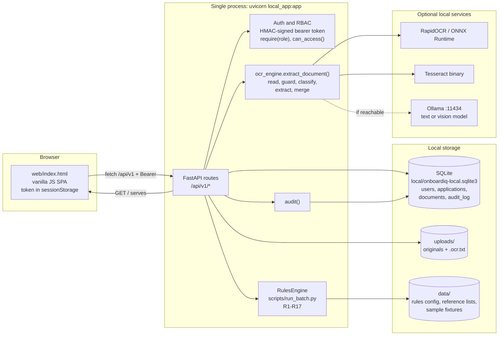

### Request lifecycle

1. The browser loads `GET /`, which returns `web/index.html`. Login (`POST /api/v1/auth/login`) returns a bearer token, which the UI keeps in `sessionStorage`.
2. Every later call sends `Authorization: Bearer <token>`. The `current()` dependency verifies the HMAC-SHA256 signature and the 8-hour expiry. `require(*roles)` checks the role, and `can_access()` limits applicants to their own applications.
3. Route handlers open a short-lived SQLite connection, perform the change, write an `audit_log` row for each state change, and commit.
4. Document uploads go through `ocr_engine.extract_document()` **before** anything is written to disk. A rejected document (unmasked Aadhaar, unreadable or unsupported file) is never stored.
5. Evaluation adapts the stored extraction fields into the shared `RulesEngine.evaluate()` interface, the same engine the batch CLI uses, and stores the result as JSON on the application.

### Authentication and authorization

- **Token format:** `base64url(JSON payload)` + `.` + `base64url(HMAC-SHA256(payload, JWT_SECRET))`. The payload carries `sub`, `roles` and `exp`, with an 8-hour lifetime. The env var is named `JWT_SECRET`, but this is a JWT-*like* token without a JOSE header, not a standards-compliant JWT.
- **Passwords:** PBKDF2-HMAC-SHA256 with 120,000 iterations and a per-user random salt.
- **Roles:** `APPLICANT`, `KYC_OFFICER`, `COMPLIANCE_OFFICER`. Self-registration always creates `APPLICANT` accounts.
- **Separation of duties:** a maker cannot recommend on an application they own, and the checker must be a different user from the maker. This applies even to `u1`, who holds both officer roles.
- **Applicant redaction:** when an applicant reads their own application, confidence scores, extraction metadata and rule details are removed from the response.

### Error handling and fallbacks

| Situation | Behaviour |
|---|---|
| Missing, invalid or expired token | `401` |
| Wrong role or another applicant's case | `403` |
| Unknown application or document | `404` |
| Action not allowed in the current status | `409` |
| Validation failure, rejected document, missing consent | `422` |
| Unsupported file type | `415` |
| File over 10 MiB | `413` |
| No OCR engine installed (image or scanned PDF uploaded) | `503`, with the install hint in `detail` |
| Ollama not running or model not pulled | Extraction continues with OCR and rules only. Availability is cached for 20 seconds. |
| Same file uploaded again within 15 minutes | Extraction result served from an in-memory cache (up to 64 entries) |

---

## End-to-end application flow

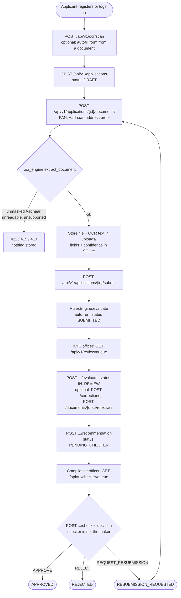

### Document upload sequence

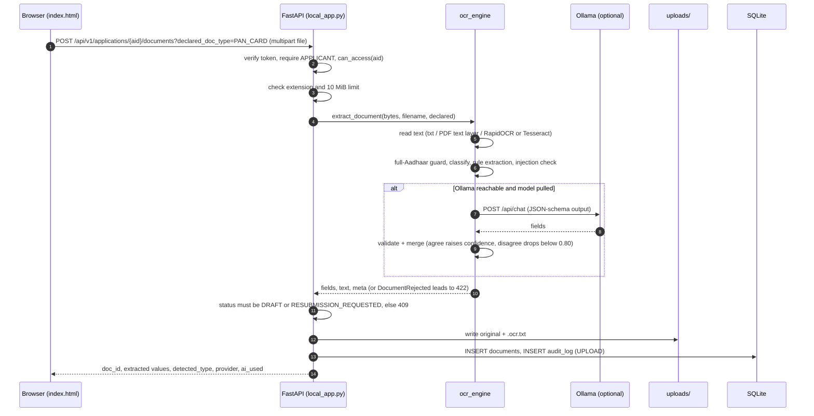

---

## Application lifecycle

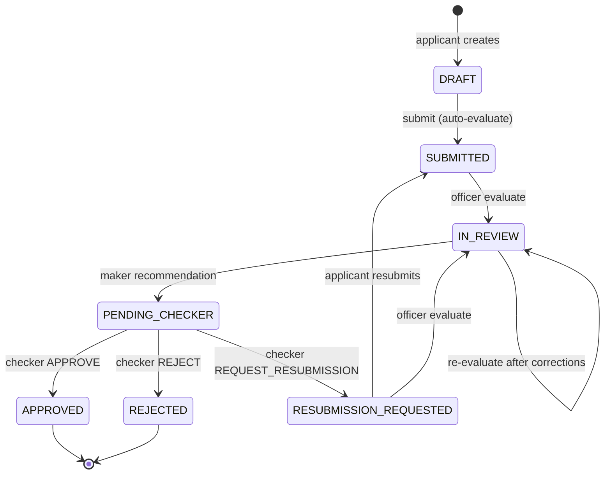

The 60 seeded sample applications are inserted as `SUBMITTED` and evaluated on first start. Documents can be added or deleted only in `DRAFT` or `RESUBMISSION_REQUESTED`.

---

## Rules engine (R1–R17)

Implemented in `RulesEngine.evaluate()` in [`scripts/run_batch.py`](scripts/run_batch.py). All thresholds come from [`data/case_02_rules_config_V1.0.json`](data/case_02_rules_config_V1.0.json). Documents are selected by their **extracted** `doc_type`, not the type the applicant declared. A field counts only if it is non-empty with confidence ≥ `min_field_confidence` (0.80).

| Rule | Reason code | Effect | Condition |
|---|---|---|---|
| R1 | `DOCUMENT_MISSING` | Review | No PAN card, Aadhaar card or address proof (electricity bill, bank statement or driving licence) |
| R2 | `DOCUMENT_TYPE_MISMATCH` | Review | Extracted type differs from declared type |
| R3 | `LOW_EXTRACTION_CONFIDENCE` | Review | Document type, or a required field on a selected document, is below 0.80 |
| R4 | `AGE_BELOW_18` | **Reject** | Age at application date < `min_age` |
| R5 | `PAN_INVALID` | **Reject** | Declared PAN fails `pan_pattern`, or the 4th character is not `P` |
| R6 | `PAN_MISMATCH` | **Reject** | PAN on the card differs from the declared PAN |
| R7 | `DOB_MISMATCH` | **Reject** | DOB on the PAN or Aadhaar card differs from the declared DOB |
| R8 | `AADHAAR_MISMATCH` | **Reject** | Aadhaar last 4 differs from the declared value |
| R9 | `NAME_MISMATCH` | **Reject** | Lowest name similarity < `name_reject_below` (0.75) |
| R10 | `SANCTIONS_MATCH` | **Reject** | Sanctions similarity ≥ 0.90 and DOB matches or is absent |
| R11 | `NAME_MISMATCH_MINOR` | Review | 0.75 ≤ name similarity < 0.90 |
| R12 | `DOCUMENT_EXPIRED` | Review | Driving licence `valid_until` before the application date |
| R13 | `ADDRESS_PROOF_STALE` | Review | Bill or statement dated in the future or older than 90 days |
| R14 | `ADDRESS_MISMATCH` | Review | Address-proof pincode differs from the declared pincode |
| R15 | `SANCTIONS_POSSIBLE_MATCH` | Review | Sanctions similarity ≥ 0.80 that is not a full match |
| R16 | `PEP_MATCH` | Review | PEP similarity ≥ 0.90 and DOB matches or is absent |
| R17 | `DUPLICATE_CUSTOMER` | Review | Declared PAN already exists among existing customers |

- **Decision:** any reject code gives `REJECT`. Otherwise any review code gives `REVIEW`. Otherwise `APPROVE`.
- **Name similarity:** Levenshtein-based, after uppercasing, removing punctuation, dropping title tokens (MR, MRS, DR, SHRI…) and sorting tokens.
- **Risk** (not computed for `REJECT`): `HIGH` for a PEP match, a possible sanctions match or a high-risk occupation. `MEDIUM` for a medium-risk occupation or annual income ≥ ₹25,00,000. Otherwise `LOW`.
- **Re-KYC due date:** application date + 2, 8 or 10 years for HIGH, MEDIUM or LOW. A 29 February application date maps to 28 February.

---

## Document AI pipeline

`ocr_engine.extract_document()` handles every upload, scan and re-extraction:

| Stage | Implementation |
|---|---|
| Read text | `.txt` used as-is. PDFs use the embedded text layer via PyMuPDF, and scanned pages are rendered and OCR'd. Images (`.png .jpg .jpeg .webp .bmp .tif .tiff`) go through **RapidOCR** by default, or **Tesseract** if selected or if it's the only engine available. |
| Guard | Rejects text containing an unmasked 12-digit Aadhaar number, or fewer than 10 readable characters |
| Classify | Keyword and structure scoring, tolerant of OCR noise: `PAN_CARD`, `AADHAAR_CARD`, `ELECTRICITY_BILL`, `BANK_STATEMENT`, `DRIVING_LICENCE`, `OTHER` |
| Extract | Document-aware parsers for `name, dob, gender, pan_number, aadhaar_last4, address, pincode, document_date, valid_until`. They repair OCR confusions (O↔0, I↔1, S↔5, B↔8). |
| Cross-check (optional) | Ollama text model on the OCR text, or a vision model on the image, with JSON-schema-constrained output. Every AI value passes the same validators. |
| Injection check | Patterns such as "ignore previous instructions" or "approve this applicant" cap `doc_type` confidence at 0.40, which forces review |

**Confidence policy** (the rules engine treats < 0.80 as unusable):

| Score | When it's assigned |
|---|---|
| 0.95 | Clean strict match |
| 0.86 | Looser or positional match |
| 0.70 | Value needed OCR repair |
| 0.75 | Found only by the LLM |
| 0.55 | Rules and LLM disagree (both readings are shown to the officer) |

### Measured extraction accuracy

Measured with `scripts/eval_extraction.py` against the supplied ground truth for 178 sample documents. The image and PDF modes render the supplied text into synthetic scans before running OCR. Re-run on 24 Oct 2026, with no LLM:

| Input | Command | Engine | Field accuracy |
|---|---|---|---|
| Supplied OCR text | `--mode text` | parsers | 99.8 % (828/830) |
| Rendered noisy scans | `--mode image --limit 45` | RapidOCR | 99.5 % (209/210) |
| Rendered noisy scans | `--mode image --limit 30` with `OCR_ENGINE=tesseract` | Tesseract | 98.6 % (137/139) |
| Image-only PDFs | `--mode pdf --limit 6` | RapidOCR | 96.4 % (27/28) |

Speed depends on the machine and is not stated here. The remaining errors are mostly OCR-garbled names, which the name-similarity rules (R9/R11) and officer review are designed to catch.

---

## Prerequisites

| Requirement | Needed for | Notes |
|---|---|---|
| **Python 3.12, 64-bit** (3.10–3.12) | Everything | See [Python version](#python-version) |
| pip | Installing dependencies | Bundled with Python |
| ~15 MB download (once) | RapidOCR model files | Fetched by `scripts/setup_ai.py` or on first OCR call |
| Tesseract binary | Optional alternative OCR engine | Windows: UB-Mannheim installer. Set `TESSERACT_CMD` if it isn't on `PATH`. |
| [Ollama](https://ollama.com) + `qwen2.5:3b` (~2 GB) | Optional LLM cross-check | `qwen2.5vl:3b` is an optional vision model |


---

## Installation

### Windows (PowerShell)

```powershell
git clone https://github.com/Aakash-Mundara/SpringBots.git
cd SpringBots
py -3.12 -m venv .venv
.venv\Scripts\python.exe -m pip install --upgrade pip
.venv\Scripts\python.exe -m pip install -r requirements-local.txt
.venv\Scripts\python.exe scripts\setup_ai.py
```

These commands call the venv's Python directly, so you don't need to run `Activate.ps1` (PowerShell blocks scripts by default). If you prefer to activate, see [Troubleshooting](#troubleshooting).

### macOS / Linux

```bash
git clone https://github.com/Aakash-Mundara/SpringBots.git
cd SpringBots
python3.12 -m venv .venv
source .venv/bin/activate
pip install --upgrade pip
pip install -r requirements-local.txt
python scripts/setup_ai.py
```

`setup_ai.py` should print a line like `OCR self-test : PERMANENT ACCOUNT NUMBER ZZKPS1234Q`. `Local LLM : off` is expected unless Ollama is running.

### Optional: local LLM

```bash
# Install Ollama from https://ollama.com, then:
ollama pull qwen2.5:3b       # text model that reads OCR output
ollama pull qwen2.5vl:3b     # optional vision model that reads images directly
```

Set the vision model before starting the app: `export OLLAMA_VISION_MODEL=qwen2.5vl:3b` on macOS/Linux, or `$env:OLLAMA_VISION_MODEL="qwen2.5vl:3b"` in PowerShell. The header chip in the UI shows `OCR: rapidocr · AI: qwen2.5:3b` when the LLM is active.

---

## Running locally

The app is one process on port 8080. It serves both the UI and the API.

```powershell
# Windows
.venv\Scripts\python.exe -m uvicorn local_app:app --host 127.0.0.1 --port 8080
```

```bash
# macOS / Linux (venv activated)
python -m uvicorn local_app:app --host 127.0.0.1 --port 8080
```

The helper scripts do the same thing and accept a `PORT` env var: `./start-local.sh` on macOS/Linux, `.\start-local.ps1` on Windows. They call `python` / `python3` from `PATH`, so activate the venv first.

| URL | What it is |
|---|---|
| http://127.0.0.1:8080 | Web UI |
| http://127.0.0.1:8080/docs | Swagger UI (generated by FastAPI) |
| http://127.0.0.1:8080/redoc | ReDoc |
| http://127.0.0.1:8080/api/v1/health | Health check, no auth |

On first start, the app creates `local/onboardiq-local.sqlite3`, seeds users and the 60 sample applications, writes their document text to `uploads/` and runs the rules engine on them. Later starts reuse the database.

---

## Demo accounts and roles

All seeded accounts use the password `Passw0rd!`.

| Username | Display name | Roles |
|---|---|---|
| `applicant1` | Demo Applicant One | `APPLICANT` |
| `applicant2` | Demo Applicant Two | `APPLICANT` |
| `u1` | Asha (KYC + Compliance) | `KYC_OFFICER`, `COMPLIANCE_OFFICER` |
| `officer2` | Rohan (KYC Officer) | `KYC_OFFICER` |
| `u2` | Meera (Compliance Officer) | `COMPLIANCE_OFFICER` |

To see a full maker-checker cycle, recommend as `officer2` and decide as `u2`, or recommend as `u1` and decide as `u2`. `u1` can't check a case they recommended.

---

## API reference

All routes are registered in [`local_app.py`](local_app.py) on a single FastAPI app, with no routers or mounted prefixes. The full list below was produced from `app.routes`: **28 endpoints under `/api/v1`**, plus `GET /` and FastAPI's built-in `/docs`, `/docs/oauth2-redirect`, `/redoc` and `/openapi.json`.

**Auth column:**
- *Public*: no token needed.
- *Any*: any valid bearer token.
- *Own*: applicants can only access their own applications. Officers can access any.

Errors use FastAPI's `{"detail": "..."}` shape. Request bodies are JSON unless marked multipart.

### Health and authentication

| Method | Path | Handler | Auth | Request | Response and notes |
|---|---|---|---|---|---|
| GET | `/` | `home` | Public | — | `web/index.html` |
| GET | `/api/v1/health` | `health` | Public | — | `{status:"UP", service, storage, database, ocr_engine}` |
| POST | `/api/v1/auth/login` | `login` | Public | `{username, password}` | `{access_token, token_type:"bearer", user{username, roles, display_name}}`. `401` on bad credentials. |
| POST | `/api/v1/auth/register` | `register` | Public | `{username (3–32, [A-Za-z0-9_.-]), password (8–128, ≥1 letter and ≥1 digit), display_name (2–100)}` | Same as login. Creates an `APPLICANT`, and the username is lower-cased. `409` if taken, `422` if the password is weak. |
| GET | `/api/v1/auth/me` | `me` | Any | — | `{username, roles}` from the token |

### Applications (applicant)

| Method | Path | Handler | Auth | Request | Response and notes |
|---|---|---|---|---|---|
| GET | `/api/v1/applications` | `applications` | Any (applicants see only their own) | Query: `status` (optional) | List with parsed `decision`, `recommendation`, `checker`, newest first |
| POST | `/api/v1/applications` | `create_application` | `APPLICANT` | `{full_name, dob (YYYY-MM-DD), pan_number (10 chars), aadhaar_last4 (4 digits), pincode (6 digits), annual_income ≥0, consent:true, gender?, mobile?, email?, address?, city?, state?, occupation_code? (default SALARIED_PRIVATE)}` | `{application_id, status:"DRAFT"}`. `422` if consent is missing or the PAN format or holder type (4th char `P`) is wrong. |
| GET | `/api/v1/applications/{aid}` | `application_detail` | Any + Own | — | Application with `documents[]` (extraction, meta), `decision`, `recommendation`, `checker`. Applicants get values only, without confidences or rule details. |
| POST | `/api/v1/applications/{aid}/documents` | `upload_doc` | `APPLICANT` + Own | Query: `declared_doc_type` = `PAN_CARD`, `AADHAAR_CARD`, `ELECTRICITY_BILL`, `BANK_STATEMENT` or `DRIVING_LICENCE`. Multipart: `file`. | `{doc_id, extraction, provider, ai_used, detected_type}`. Runs OCR and the guards before storing. Errors: `415` type, `413` size, `422` rejected or empty, `503` no OCR engine, `409` wrong status. |
| DELETE | `/api/v1/applications/{aid}/documents/{docid}` | `delete_doc` | `APPLICANT` + Own | — | `{ok:true}`. Deletes the row and files. `409` after submission. |
| POST | `/api/v1/applications/{aid}/submit` | `submit` | `APPLICANT` + Own | — | `{application_id, status:"SUBMITTED"}`. Needs consent and ≥1 document. Runs the rules engine automatically. |
| GET | `/api/v1/applications/{aid}/timeline` | `timeline` | Any + Own | — | Audit rows whose `entity_id` is the application or whose `detail` mentions it |

### Documents and OCR

| Method | Path | Handler | Auth | Request | Response and notes |
|---|---|---|---|---|---|
| POST | `/api/v1/ocr/scan` | `ocr_scan` | `APPLICANT` | Multipart: `file` | `{fields{k:{value, confidence}}, ocr_engine, ai_used, duration_ms}`. Reads without storing anything (used for form autofill). |
| GET | `/api/v1/ocr/status` | `ocr_status` | Any | — | `{ocr_engine, engines{rapidocr, tesseract, pdf, pillow}, ai{…}, supported_extensions}` |
| GET | `/api/v1/documents/{docid}/content` | `document_content` | Any + Own | — | The original file, inline, with its stored media type |
| GET | `/api/v1/documents/{docid}/ocr` | `document_ocr` | Any + Own | — | `{doc_id, text, media_type, meta}`. `meta` is empty for applicants. |
| POST | `/api/v1/documents/{docid}/reextract` | `reextract` | `KYC_OFFICER` | — | `{doc_id, extraction, meta}`. Re-runs OCR and AI, and keeps fields with `source: OFFICER_CORRECTION`. |
| GET | `/api/v1/reference/occupations` | `occupations` | Any | — | `[{code, description}]` |

### Review (maker) and approval (checker)

| Method | Path | Handler | Auth | Request | Response and notes |
|---|---|---|---|---|---|
| GET | `/api/v1/review/queue` | `review_queue` | `KYC_OFFICER` or `COMPLIANCE_OFFICER` | — | Applications in `SUBMITTED`, `IN_REVIEW` or `RESUBMISSION_REQUESTED`, with `decision` |
| POST | `/api/v1/applications/{aid}/evaluate` | `evaluate` | `KYC_OFFICER` or `COMPLIANCE_OFFICER` | — | Rules result `{application_id, decision, reason_codes, name_match_score, risk_category, rekyc_due_date, rule_details}`. Sets `IN_REVIEW`. `409` from other statuses. |
| POST | `/api/v1/applications/{aid}/corrections` | `correction` | `KYC_OFFICER` | `{doc_id, field_name, value, reason (3–1000)}` | `{ok, old_value, new_value}`. Sets the field to confidence 1.0, `source: OFFICER_CORRECTION`, and audits old and new values. |
| POST | `/api/v1/applications/{aid}/recommendation` | `recommendation` | `KYC_OFFICER` | `{recommendation: APPROVE, REJECT or REQUEST_RESUBMISSION, comment (3–2000)}` | Recommendation record. Sets `PENDING_CHECKER`. Needs `IN_REVIEW` with a rules result (`409`). `403` if the officer owns the application. |
| GET | `/api/v1/checker/queue` | `checker_queue` | `COMPLIANCE_OFFICER` | — | `PENDING_CHECKER` applications with the maker's `recommendation` |
| POST | `/api/v1/applications/{aid}/checker-decision` | `checker_decision` | `COMPLIANCE_OFFICER` | `{decision: APPROVE, REJECT or REQUEST_RESUBMISSION, comment (3–2000)}` | `{status, checker}`. Sets `APPROVED`, `REJECTED` or `RESUBMISSION_REQUESTED`. `403` if the checker is the maker. `409` without a recommendation. |

### Oversight and administration

| Method | Path | Handler | Auth | Request | Response and notes |
|---|---|---|---|---|---|
| GET | `/api/v1/dashboard` | `dashboard` | `KYC_OFFICER` or `COMPLIANCE_OFFICER` | — | `{applications_by_status, evaluations_by_decision}` |
| GET | `/api/v1/audit` | `audit_list` | `COMPLIANCE_OFFICER` | Query: `limit` (default 100, clamped to 1–500) | Latest audit rows `{id, at, actor, action, entity, entity_id, detail}` |
| GET | `/api/v1/audit/export.csv` | `audit_export` | `COMPLIANCE_OFFICER` | — | `text/csv` attachment `audit.csv` with the full log |
| GET | `/api/v1/admin/rules-config` | `rules_config` | `COMPLIANCE_OFFICER` | — | Contents of `case_02_rules_config_V1.0.json` |
| GET | `/api/v1/admin/reference-data` | `reference_data` | `COMPLIANCE_OFFICER` | — | `{occupations, sanctions_count, pep_count, existing_customers_count}` |

Audited actions: `SEED`, `REGISTER`, `CREATE`, `UPLOAD`, `DELETE_DOCUMENT`, `SUBMIT`, `AUTO_EVALUATE`, `EVALUATE`, `REEXTRACT`, `FIELD_CORRECTION`, `RECOMMEND`, `CHECKER_DECISION`.

---

## Frontend views

`web/index.html` is a single page with no URL routing. Views are in-memory tabs chosen by `go(tab)`, and the sidebar shows only the tabs your roles allow.

| Tab | Shown to | What it does |
|---|---|---|
| My applications | Applicant | List with progress stepper. Open one to see detail, documents and outcome, and to resubmit. |
| New application | Applicant | Form plus three document slots (PAN, Aadhaar, address proof) with drag and drop and OCR autofill |
| Review queue | KYC officer | Filter by rules outcome. Open a case workbench: declared data vs extracted fields, original and OCR-text viewer, confidence bars, corrections, re-extract, run rules, recommend. |
| All applications | KYC officer or compliance officer | All applications with status |
| Approval queue | Compliance officer | Cases pending checker. Full case view with the maker's rationale and the final decision. |
| Dashboard | Officers | Counts by status and by rules decision |
| Audit log | Compliance officer | Searchable log with CSV download |
| Rules & reference | Compliance officer | Rules config and reference data |

The session token is stored in `sessionStorage`, so closing the tab logs you out.

---

## Command-line tools

| Command | Purpose | Arguments |
|---|---|---|
| `python scripts/setup_ai.py` | Downloads the OCR models, runs a self-test and reports Ollama status. Exits 1 if no OCR engine is installed. | none |
| `python scripts/run_batch.py` | Runs the rules engine over a CSV batch and writes `application_id,decision,reason_codes,name_match_score,risk_category,rekyc_due_date` | `--data` (default `data/`), `--applications`, `--documents`, `--extraction`, `--output` (default `output/decisions_output.csv`), `--verify-sample` |
| `python scripts/eval_extraction.py` | Measures extraction accuracy against `case_02_document_truth_sample_V1.0.csv` and re-runs rules on the real extraction | `--mode text\|image\|pdf`, `--limit N`, `--ai`, `--out` (default `output/extraction_eval.csv`) |
| `python ocr_engine.py [files…]` | With no arguments, prints engine and LLM status as JSON. With files, prints their extraction. | file paths |

```bash
# Sample set: compare against expected labels (exits 1 on any mismatch)
python scripts/run_batch.py --verify-sample --output output/test_decisions.csv

# Evaluation set (100 applications)
python scripts/run_batch.py \
  --applications data/case_02_applications_eval_V1.0.csv \
  --documents data/case_02_documents_eval_V1.0.csv \
  --extraction data/case_02_extraction_mock_eval_V1.0.csv \
  --output output/eval_preview.csv
```

> [!NOTE]
> `--output` defaults to `output/decisions_output.csv`, which holds the committed 60-row sample results. Running the sample without `--output` rewrites that file. The rows are the same, but the line endings may differ, so git can show it as modified.

---

## Testing and verification

```bash
python -m unittest discover -s tests -v          # 17 tests
python -m unittest tests.test_rules_engine -v    # one module
python -m unittest tests.test_ocr_engine.ExtractionTests.test_pan_text   # one test
```

On Windows, replace `python` with `.venv\Scripts\python.exe`.

| Module | Tests | Covers |
|---|---|---|
| `test_local_app.py` | 4 | Health and login, applicant ownership scoping, evaluate, recommend and checker separation, full-Aadhaar upload rejection |
| `test_ocr_engine.py` | 8 | PAN text parsing, OCR-repair confidence, Aadhaar guard, prompt-injection flag, accuracy on the supplied sample text, image OCR (skipped if no OCR engine), LLM cross-check against a fake Ollama HTTP server, register → upload → evaluate flow |
| `test_rules_engine.py` | 5 | All 60 golden sample applications, 100-row eval output, worked similarity, sanctions and PEP examples, config-driven thresholds |

The tests use temporary SQLite files (via `ONBOARDIQ_DB`), so they don't touch `local/onboardiq-local.sqlite3`. They do write seeded document text into `uploads/`, and `test_rules_engine` writes `output/test_decisions.csv`. Both are git-ignored. No test needs Ollama or network access.

**Last verified run (24 Oct 2026):** 17/17 passed. `--verify-sample`: 60/60 applications fully matched, 0 field mismatches. The 100-row eval output was byte-identical to the committed `output/eval_preview.csv`.

The repository has no linter, formatter, type-checker or coverage configuration, and no CI workflow.

---

## Example requests

```bash
# Health
curl http://127.0.0.1:8080/api/v1/health

# Log in as an officer and keep the token
TOKEN=$(curl -s -X POST http://127.0.0.1:8080/api/v1/auth/login \
  -H "Content-Type: application/json" \
  -d '{"username":"u1","password":"Passw0rd!"}' | python -c "import sys,json;print(json.load(sys.stdin)['access_token'])")

# Review queue
curl -H "Authorization: Bearer $TOKEN" http://127.0.0.1:8080/api/v1/review/queue

# Scan a document without storing it (applicant token required)
curl -X POST -H "Authorization: Bearer $APPLICANT_TOKEN" \
  -F file=@samples/Ravi_Kumar_Sharma_pan_card.png \
  http://127.0.0.1:8080/api/v1/ocr/scan
```

```powershell
# PowerShell
$r = Invoke-RestMethod -Method Post -Uri http://127.0.0.1:8080/api/v1/auth/login `
  -ContentType 'application/json' -Body '{"username":"u1","password":"Passw0rd!"}'
Invoke-RestMethod -Uri http://127.0.0.1:8080/api/v1/dashboard -Headers @{ Authorization = "Bearer $($r.access_token)" }
```

### Try the upload demo

`samples/` holds synthetic specimens for two applicants:
- `Ravi_Kumar_Sharma_*` should come out as a clean match. Its PAN reads as `ZZKPS1234Q`.
- `Arjun_Nair_*` should trigger a PAN mismatch.

Register a new account, open **New application**, drop the three files into their slots and the form fills itself.

---

